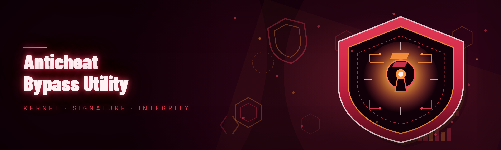

  
  
  

  

  
  
  
  

---

Kernel-level anticheat bypass with HWID spoofer, EAC/BE/VAC detection evasion, manual-mapped injector, and signature scrubbing for undetected cheat loading.

## Overview

Kernel-level anticheat bypass with HWID spoofer, EAC/BE/VAC detection evasion, manual-mapped injector, and signature scrubbing for undetected cheat loading.

  

## License

[MIT License](LICENSE)

  

